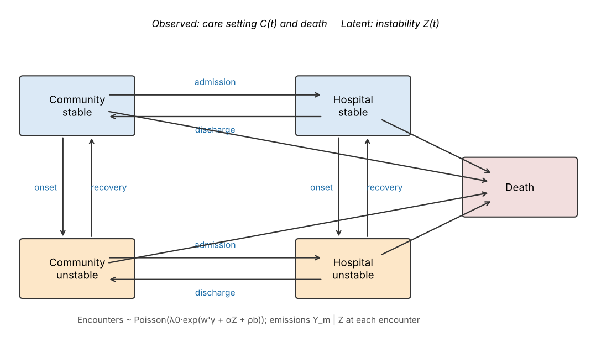
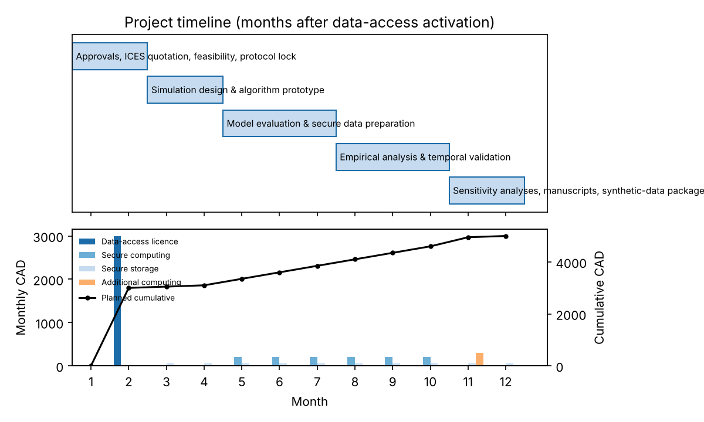

# Bayesian latent multi-state methods for health-care trajectories in older adults with multimorbidity

Reproducible code for the CANSSI Ontario Data Access Grant project (requested CAD 5,000; 12 months).
A **continuous-time hidden multi-state model** separates *observed* care-setting transitions
(community ↔ hospital → death) from *latent* clinical instability that is seen only through
diagnostic codes at irregular, **informative** health-care encounters.

> ⚠️ Everything in this repository runs on **synthetic** data. Real ICES data never leave the
> approved secure environment (see [docs/governance.md](docs/governance.md)).



## Model in one paragraph
Joint state X(t) = (C(t), Z(t)): community/stable, community/unstable, hospital/stable,
hospital/unstable, death. Transition intensities `q_rs = q0_rs,k · exp(x'β + η b)` with
piecewise-constant baselines (days 0–30, 31–90, 91–365) and a shared random effect
`b ~ N(0, σ²)`. Encounters in the community arrive at rate `λ0 · exp(w'γ + αZ + ρb)`; at each
encounter, indicators follow `logit P(Y_m = 1 | Z) = a_m + d_m Z`, `d_m > 0`. The likelihood is a
constrained forward recursion using `exp{(Q_cc − D_λ)Δt}` between observed events (so unrecorded
care transitions are never integrated over), with Gauss–Hermite quadrature over `b`.

## Repository layout
```
src/hmsm/          model.py · likelihood.py · fit.py · predict.py · simulate.py · simstudy.py
                   cohort.py · missing.py · validation.py · plots.py
scripts/00-09      numbered pipeline (see table below)
config/            protocol.yaml (locked cohort definition) · simulation.yaml (preregistered design)
stan/ R/           HMC implementation (hidden_msm.stan, fit_stan.R) for the secure environment
sas/               cohort-construction template for ICES (placeholders for variable names)
budget/            budget_items.csv (from the application) · expenditure_tracker.csv
results/           figures/ (F0-F13) and tables/ (T1-T14), all regenerated by `make all`
tests/             unit tests (run in GitHub Actions)
docs/              governance, project plan (milestones/issues), protocol amendments
```

## Quick start
```bash
git clone https://github.com/<org>/canssi-hidden-msm.git && cd canssi-hidden-msm
python -m venv .venv && source .venv/bin/activate
pip install -r requirements.txt
make test          # 8 unit tests
make all           # synthetic data -> cohort -> simulation -> fit -> validation -> budget
```

| Step | Script | Output |
|---|---|---|
| Synthetic DAD/NACRS/OHIP/RPDB | `00_make_synthetic_ices.py` | `data/synthetic/` |
| Cohort under locked protocol | `01_build_cohort.py` | T1, F1 |
| Prior predictive check | `02_prior_predictive.py` | T2, F2, F0 |
| Simulation study (16 scenarios + stress tests) | `03_run_simulation.py` | `results/sim/` |
| Simulation summary (bias, RMSE, coverage, MCSE) | `04_summarize_simulation.py` | T3–T5, F4–F7 |
| Empirical fit + estimands | `05_fit_empirical.py` | T6–T9, F8–F10 |
| Temporal validation | `06_validate.py` | T10, F11 |
| Sensitivity analyses | `07_sensitivity.py` | T11 |
| Budget, cash-flow, compute estimate | `08_budget_plan.py` | T12–T14, F12–F13 |
| HMC (Stan) export / fit | `09_export_stan_data.py`, `R/fit_stan.R` | `results/hmc/` |

The simulation runner is resumable and shardable for cluster array jobs:
`python scripts/03_run_simulation.py --mode full --shard $SLURM_ARRAY_TASK_ID --n-shards 50`.

## Estimation
* **Pilot / simulation estimator (Python, runs anywhere):** posterior mode by BHHH with
  Levenberg damping, Laplace approximation to the posterior; estimand intervals from posterior
  draws pushed through the transition law.
* **Production estimator (HMC):** `stan/hidden_msm.stan` via `R/fit_stan.R`, initialised at the
  Laplace mode; 4 chains × 1,000 warm-up + 1,000 draws; R-hat < 1.01, bulk/tail ESS ≥ 400,
  no divergences. *Not executed in development (no Stan available); validate before use.*

## Results so far (synthetic data, pilot scale)
**Simulation pilot** (16 scenarios, n = 1,000 / 2,000, **4 replicates each**, so Monte Carlo error is large;
T3a averages over scenarios):

| Estimand | Method | Bias | 95% coverage |
|---|---|---|---|
| 30-day death | Proposed | +0.002 | 0.91–0.97 |
| 30-day death | Naive observed-state | −0.008 | 0.00–0.13 |
| 365-day any hospitalisation | Proposed | −0.003 to −0.006 | 0.91 |
| 365-day any hospitalisation | Naive | +0.025 to +0.029 | 0.34–0.41 |
| log admission rate, unstable (informative visits) | Hidden MSM ignoring informative visits | −0.26 | 0.41 |
| same | Proposed | −0.03 | 1.00 |

127 of 128 hidden-model fits in the main grid converged (proposed 63/64; non-informative 64/64).

**Empirical demonstration** (synthetic ICES-style cohort, N = 4,301; training 3,724, temporal holdout 577):
30- and 90-day risks recover the known synthetic truth closely (e.g. 30-day death 0.039 vs truth 0.038),
but 365-day death (0.143 vs 0.157) and any-hospitalisation (0.495 vs 0.522) are under-estimated, with
intervals excluding the truth. Covariate misclassification introduced by the cohort builder and
date discretisation are candidate explanations and are open issues. On the holdout, Brier scores were
similar across models; the proposed model improved on the naive model only for 30-day hospitalisation
(ΔBrier 0.0022, bootstrap 95% CI 0.0006–0.0038). Results were stable to prior SD, quadrature nodes,
reduced emissions and same-day ordering; removing the random effect raised 365-day hospitalisation risk
(0.526 vs 0.502).

## Budget (CAD 5,000; no personnel costs)
| Item | CAD | Months |
|---|---|---|
| Data-access licence (ICES; quotation pending) | 3,000 | 2 |
| Secure computing (200/month × 6) | 1,200 | 5–10 |
| Secure storage (50/month × 10) | 500 | 3–12 |
| Additional computing (robustness scenarios) | 300 | 11 |

`08_budget_plan.py` also estimates compute from measured pilot run times: the full preregistered
design needs ≈ 57 CPU-hours with the Laplace estimator (≈ 86 with a 1.5× margin; n = 10,000 is an
extrapolation). HMC fits are far more expensive and are reserved for the empirical analysis.
Because the simulation study uses only synthetic data, it can run outside the secure environment
(e.g. on institutional or national academic computing), reserving the paid secure allocation for
work on real records. Record invoices in `budget/expenditure_tracker.csv`; actual invoices, not
estimates, determine expenditure.



## Known limitations / open issues
* Time-since-state-entry (semi-Markov) and rare-transition stress tests are not yet implemented.
* Pilot uses 4 replicates per scenario; the preregistered design is 200 (500 for boundary scenarios).
* Laplace intervals use the BHHH (outer-product) information; HMC is the reference.
* Loss-of-eligibility IPCW is implemented for validation metrics; a weighted-likelihood sensitivity
  analysis is planned.
* Synthetic diagnosis codes and chronic-condition lists are placeholders, **not** validated ICES algorithms.

## Citation & licence
See `CITATION.cff`. Code: MIT. Results are prognostic associations, not causal effects.
